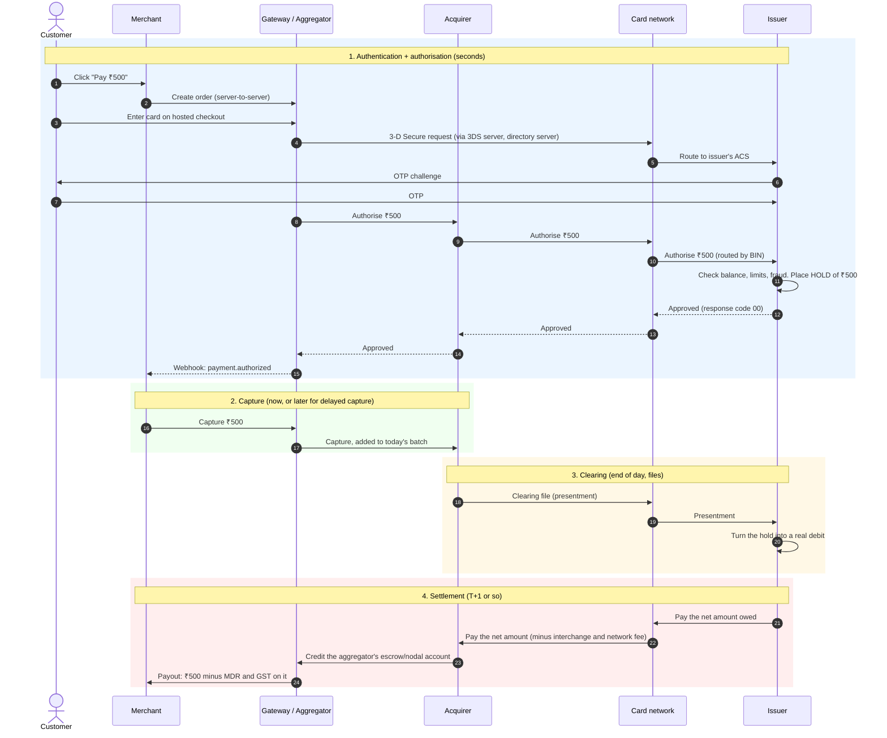

# A ₹500 card payment, end to end

Four phases: **authorisation** (a hold is placed), **capture** (merchant confirms the sale),
**clearing** (the details are exchanged) and **settlement** (money actually moves).

## Who holds the money at each step

| Step                  | Where the ₹500 is                                                              |
| --------------------- | ------------------------------------------------------------------------------ |
| After authorisation   | Still in the customer's account, **blocked** (debit) or limit reduced (credit) |
| After capture         | Same. Capture is an instruction, not a transfer                                |
| After clearing        | Debited by the issuer, owed to the network's settlement                        |
| During settlement     | Moves issuer → network settlement → acquirer → aggregator's **escrow** account |
| After merchant payout | In the merchant's bank account, minus MDR + GST                                |

A pure **gateway** never holds the money: the acquirer pays the merchant directly. An
**aggregator** (Razorpay, Cashfree, AtomPay) receives it into an escrow account and settles the
merchant itself, which is why the RBI authorises aggregators.

## What breaks

- **Auth succeeded, our response lost:** customer's money is held, we don't know. That's the
  `UNKNOWN` state (Day 19). We ask again; we never guess.
- **Authorised, never captured:** the hold expires after some days and the customer gets it back.
- **Captured, customer disputes later:** chargeback. The issuer pulls the money back through the
  network; the merchant must prove the sale.
