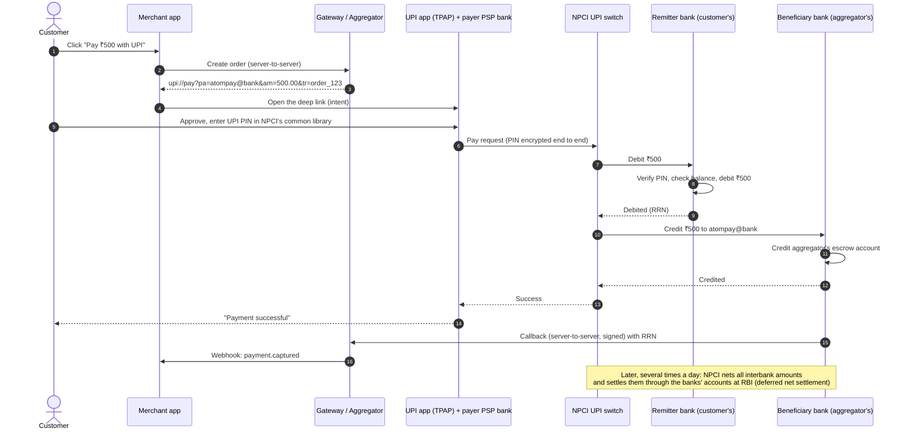

# A ₹500 UPI payment, end to end

UPI is a **push** payment: the customer's own bank debits them after they enter their UPI PIN.
There is no separate authorisation and capture. Debit and credit happen in seconds; the banks
settle with each other later, through NPCI.

## Intent flow (merchant opens the customer's UPI app)

## Collect flow (merchant asks, customer approves)

The merchant sends a payment **request** to the customer's UPI ID (`akshay@okbank`). The customer
gets a notification in their UPI app and approves it with their PIN. From the PIN onwards, the
money moves the same way as above.

|                | Intent                                   | Collect                                                                        |
| -------------- | ---------------------------------------- | ------------------------------------------------------------------------------ |
| Who starts it  | Customer's app is opened by the merchant | Merchant sends a request to a UPI ID                                           |
| Customer types | Nothing but the PIN                      | Their UPI ID on the merchant page, then the PIN                                |
| Fraud risk     | Low: the customer is already paying      | High: fraudsters send "collect" requests pretending they are refunds or prizes |
| Today          | Default on mobile                        | NPCI has been restricting it; P2P collect was stopped in 2025                  |

## Who holds the money at each step

| Step                     | Where the ₹500 is                                                            |
| ------------------------ | ---------------------------------------------------------------------------- |
| Before the PIN           | Customer's bank account                                                      |
| After the remitter debit | Left the customer's account; the remitter bank owes it to the beneficiary    |
| After the credit         | In the aggregator's escrow, at the beneficiary bank. The bank fronts it      |
| After NPCI settlement    | Interbank money has really moved, through the banks' RBI accounts            |
| After merchant payout    | In the merchant's bank account, minus fees (MDR on UPI is zero for most P2M) |

## What breaks

- **Debited but no success response:** the transaction is pending/deemed. The gateway calls the
  status-enquiry API (with limits on how often), never marks it failed on its own.
- **Debited, credit failed:** the remitter bank auto-reverses it within RBI's turnaround time.
- **Customer sees success, merchant shows failed:** the merchant trusted the redirect instead of
  the server-to-server callback or webhook.
